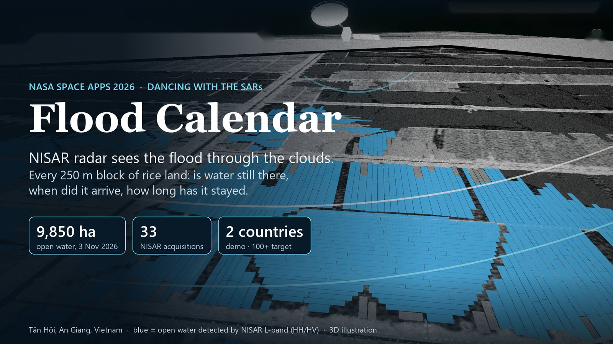
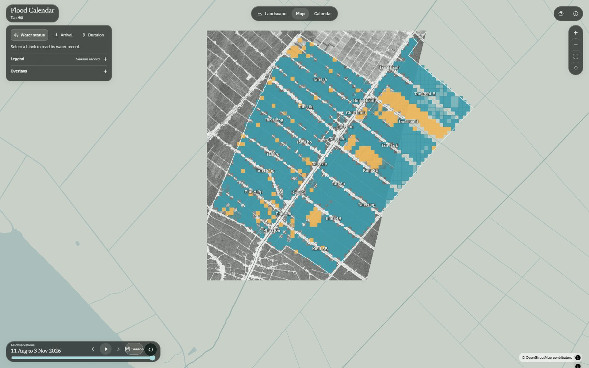

# Flood Calendar



*A flood calendar for every 250 m block of flooded rice land, kept by NASA–ISRO NISAR radar. Demonstrated in Vietnam and Thailand; designed for every country that grows flooded rice.*

Team **Dancing with The Paddies** · Ho Chi Minh City University of Technology (HCMUT), Vietnam National University Ho Chi Minh City (VNU-HCM) · NASA Space Apps Challenge 2026 · Challenge: *Dancing with the SARs*

**Team members:** Khưu Huỳnh Gia Hưng (team lead); Lê Nguyễn Minh Tân, Lê Viễn Bằng and Lý Anh Quân (backend: radar pipeline and data); Phạm Anh Quốc and Lê Quang (frontend: web and video).

**Web app:** https://floodcalendar.pages.dev · **Demo video (30 s):** https://drive.google.com/file/d/1Rb9ujhvlkRmKDEZBBRMMePUZH5zd6cvU/view

## At a glance

| | |
| --- | --- |
| **Problem** | Flooded rice fields must be drained before the sowing calendar closes (31 December 2026 in An Giang, Vietnam). Communes are told to track the flood but have no map of where water still stands, and the flood season is the cloudy season |
| **What we built** | A flood calendar for every 250 m block from NISAR L-band radar: is open water still there, when did it arrive, how long has it stayed. Public web app with replayable map, data sound, 3D scene and guided tour |
| **Who decides with it** | Commune People's Committee and agricultural cooperatives (roles taken from the commune's published Plan 122) |
| **NASA data** | NISAR L2 GCOV, 33 acquisitions in 2026 (22 Vietnam, 11 Thailand); OPERA DSWx-S1 for comparison; NASA CMR for search |
| **Result** | Tân Hội: open water grew from 1,206 ha (16 Aug) to 9,850 ha (3 Nov 2026); 1,281 ha where water is no longer seen. Bang Rakam: 331 ha (14 Aug) to 1,756 ha (31 Oct 2026) |
| **Reach** | Vietnam and Thailand are the demonstration: two countries, one codebase. The design target is flooded rice anywhere NISAR passes, in the 100+ countries that grow rice. A new site takes three steps: a site file, a threshold review and a comparison with a reference water product |
| **Agreement with NASA OPERA DSWx-S1** | Median Cohen's kappa 0.56 in Tân Hội (19 pass pairs) and 0.57 in Bang Rakam (8 pairs); post-hoc, not independent validation |
| **Limits** | Not yet tested with commune staff. The pumping-out phase is still ahead of the record |
| **Try it** | https://floodcalendar.pages.dev · 30 s video (link above) · verify the published data offline with [Quick start](#quick-start) |

> **The problem.** Rice is the staple food of more than half of the world's population, and most of it is grown in flooded fields (IRRI Rice Almanac). When the water leaves late, sowing bunches up and the harvest bunches up months later. In An Giang, Vietnam, both were reported last season. The flood receded slowly and sowing bunched together, the provincial agriculture department said. In April 2026 the harvest bunched too: reporters found combine harvesters short in other An Giang communes, lodged rice waiting in the fields, and some farmers losing 500–700 VND per kilogram ([details](#the-problem)). This season the sowing calendar closes on **31 December 2026**. The commune's own plan orders its People's Committee and cooperatives to track the flood across 24 hamlets, but gives them no map of where water still stands, and in the flood season the delta is often under cloud, which limits optical satellites.
>
> **What we built.** Flood Calendar turns open NASA–ISRO NISAR L-band radar, which sees water through cloud, day and night, into a flood calendar for every 250 m block: is open water still there, when did it arrive, how long has it stayed. It runs today on real 2026 NISAR data in a public web app with a replayable map, data sound and a 3D scene. In Tân Hội commune (2,344 blocks, 14,650 ha), 22 radar passes show open water growing from 1,206 ha on 16 August (the first date on which every block had been observed) to **9,850 ha** by 3 November 2026, two days after the sowing calendar opened on 1 November. That is two-thirds of the 14,650 ha we mapped, and every one of those blocks is mostly cropland in ESA WorldCover 2021. Our grid holds 13,519 ha of mostly-cropland blocks, more than the plan's 9,622 ha of diked fields, so the two areas are not the same boundary. The flood is still at its widest, so the pumping-out phase is not in the record yet; so far the map marks 1,281 ha where open water is no longer seen, the first places a cooperative could check.
>
> **Designed for the world; Vietnam and Thailand are the demonstration.** The method is not specific to one country. The same code and the same web app already run on two rice plains in two countries with different flood regimes: Tân Hội in An Giang, Vietnam, and Bang Rakam in Phitsanulok, Thailand. NISAR images nearly all of Earth's land every 12 days and its data are free, so the same calendar can be kept wherever rice is flooded. The target is the **100+ countries** that grow rice. A new site takes three steps, and the second site showed that each is needed: it required its own site file, a threshold review and handling for mixed 10 m and 20 m pixels, and one of its three NISAR tracks gave no usable data ([what a new site takes](#beyond-the-two-demo-sites-what-a-new-site-takes)).



*Map view of the web app for Tân Hội, all radar passes from 11 August to 3 November 2026. Blue: water present on the block's latest radar pass. Orange: open water no longer seen on the latest pass (not confirmed drained). Grey background: NISAR radar backscatter. Screenshot of https://floodcalendar.pages.dev/map/ taken on 15 November 2026.*

## How the project answers the judging criteria

- **Impact.** A dated, block-by-block answer to a decision that a commune's own plan already assigns to named bodies: when to pump and where to check first. Free data and one codebase are what let it move from one commune to other flooded rice plains; each new site needs its own threshold review.
- **Creativity.** A calendar for each block (arrival range, days under water, current status), told as a replayable map, as sound that follows the water area, and as a 3D scene with a narrated tour.
- **Validity.** Real 2026 NISAR data, 33 acquisitions over two sites. Open code, JSON Schemas and an offline checker for every published file. Compared with NASA OPERA DSWx-S1, with the comparison stated as post-hoc. The limits are listed in [Limits](#limits).
- **Relevance.** SAR is the whole measurement, not an add-on: open water is detected from NISAR L-band HH and HV backscatter, through cloud, in the season when cloud limits optical satellites.
- **Presentation.** A live web app, a 30-second video, and this README with commands to check the published data offline.

## The problem

Every autumn, Tân Hội commune in An Giang, Vietnam, opens the dikes around its rice fields after the Autumn–Winter harvest and lets the Mekong flood in. This is deliberate: the flood brings silt and cleans the fields between crops. Then the water has to be pumped out again before Winter–Spring rice can be sown, and the province's sowing calendar for that crop closes on 31 December 2026. A field that still holds water cannot be sown.

Last season showed what is at stake. The 2025 flood was high and receded slowly, so sowing in An Giang bunched together, the provincial Department of Agriculture and Environment said. In April 2026, reporters found the harvest bunched too. In An Giang communes such as Hòn Đất and Giồng Riềng, combine harvesters ran short, lodged rice waited in the fields, and some farmers lost 500–700 VND per kilogram on price as traders withdrew deposits (Báo Tin tức / Vietnam News Agency, 9 April 2026). A block-by-block view of where water still stands, refreshed every few days but about two weeks behind, could help a commune see uneven drainage before the calendar closes.

The commune's own plan sets out who has to make this work (Plan 122/KH-UBND, 12 May 2026, following provincial Letter 3767/SNNMT-KH). It covers 24 hamlets and 9,622 ha of diked fields:

- The **Commune People's Committee** sets the sowing window and the flood-release timing, and must update the flood level to adjust the sowing calendar.
- The **flood-release zones** pump the water out so they can sow within the calendar.
- The **cooperatives** track the water and announce the flood-release schedule to farmers.

Each of these duties needs the same answer: where is open water still standing, hamlet by hamlet, and since when? The plan asks the commune to track the flood; it does not give it a map of the flood. The season when the answer matters most is also the season when the delta is often under cloud, which limits optical satellites. Radar is not limited by cloud.

Reports give totals, not places. In the 2025 season, a provincial sowing report listed 25,053 of 505,712 ha (4.95%) of An Giang's planned Winter–Spring rice as sown (Official Letter 5395/SNNMT-CCTTBVTV). A number like that says how far the season has gone, not which fields still hold water.

## Who it is for

| User (from Plan 122) | Decision | What Flood Calendar gives them |
| --- | --- | --- |
| Commune People's Committee, Tân Hội | Sowing window and flood-release timing for 24 hamlets; when to adjust the calendar | For each 250 m block: is open water still seen, when it arrived, how long it has stayed. Summarised by nearest hamlet (hamlet names from OpenStreetMap) |
| Agricultural cooperatives | Which areas to check first before announcing the schedule to farmers | Blocks where open water is no longer seen, and blocks where it is still seen, on the latest radar date. This does not mean a field is ready to sow |
| Later: provincial department | Progress across communes | The same view for other communes, after site set-up and a threshold review |

Flood Calendar does not replace a field visit. It shows where to send one.

NISAR data reaches us about two weeks after acquisition, so the map shows recent weeks, not today. Every date is a range between two radar passes.

These users and decisions come from the commune's published plan. We have not yet put the tool in front of commune staff; that is the next step.

## What it does

Flood Calendar uses NISAR L-band radar to answer three questions for every 250 m block of Tân Hội commune (2,344 blocks, 14,650 ha):

1. **Is open water still there?**
2. **How long has the field been under water?** Given as a minimum and a maximum number of days.
3. **When did the water arrive?** Given as a date range. On dry, flat fields the radar can mark the start earlier than it happened on the ground.

Each NISAR track revisits every 12 days, so every date is a range between two radar passes, never a single day.

The web app includes:

- A map that can be replayed radar pass by radar pass, and a chart for any single block.
- Data sound: tones follow the water area of each radar pass. The ambient landscape sound is illustrative.
- A 3D scene of each site with a narrated guided tour. The scene is an illustration (see [Limits](#limits)).
- A layer for fields flooded more than 30 days before the season. The IPCC 2019 guidelines give such fields a higher methane scaling factor (Table 5.13). The layer only flags blocks, relevant *if the IPCC default factor applies*; it does not estimate emissions.

Bang Rakam (Thailand) has 2,304 blocks and 11 radar passes in a 12 × 12 km study frame, in the same web app.

What it does **not** do: it does not measure methane, and it cannot tell whether a field was sown right after the water left.

## Why NISAR

Flat open water reflects NISAR's L-band radar away from the satellite, so it shows dark in both HH and HV, with or without cloud, day or night. Tân Hội is covered by three NISAR tracks, so most blocks get a new look every 3–5 days, from free NASA data (one track misses about 14% of the blocks).

Radar mapping of flooded rice is established work: ALOS-2 PALSAR-2 inundation monitoring in An Giang (Hoang-Phi et al., 2026), multi-frequency SAR in Thai paddies (Kitratporn et al., 2026), the CH4Rice project, Arai et al. (2018) in the Mekong Delta, and NASA's OPERA DSWx-S1 surface-water product from C-band radar. What Flood Calendar adds is a calendar for each block (arrival range, days under water, current status) from NISAR's L-band, organised around the decisions in a commune's own plan, and told with a replayable map, sound and a 3D scene.

## Beyond the two demo sites: what a new site takes

Vietnam and Thailand are where we demonstrate Flood Calendar. They are not its limit.

**What the two demo sites show.** The same pipeline and the same web app run on two rice plains in two countries with different flood regimes, different NISAR tracks and different pixel sizes:

| | Tân Hội, An Giang, Vietnam | Bang Rakam, Phitsanulok, Thailand |
| --- | --- | --- |
| Why it floods | The commune lets the Mekong flood in on purpose after the harvest, then pumps it out before sowing | Thailand's Royal Irrigation Department manages the plain as a flood-retention area; its 2026 plan has farmers sow from 1 April and finish the harvest by mid-August so that the fields can take floodwater |
| Grid | 2,344 blocks of 250 m (14,650 ha) | 2,304 blocks of 250 m (14,400 ha), a 12 × 12 km study frame |
| NISAR record | 22 radar passes from three tracks, 11 August–3 November 2026 | 11 radar passes from two tracks, 14 August–31 October 2026 (a third track gave no usable data) |
| What the calendar shows | Open water grew from 1,206 ha to 9,850 ha | Open water grew from 331 ha to 1,756 ha |

**Why it can go anywhere rice is flooded.** Rice is grown in 100+ countries (117 rice-producing countries in the IRRI Rice Almanac, 4th edition). NISAR images nearly all of Earth's land every 12 days, through cloud, and its data are open. Wherever rice fields are flooded and NISAR passes over, the same three questions can be asked: is open water still seen, when did it arrive, how long has it stayed.

**What a new site takes.** Three steps. Bang Rakam showed that each one is needed:

1. A site file: study area, NISAR tracks, grid and reference areas (`config/sites/`).
2. A threshold review for that site's images. Bang Rakam needed per-image thresholds and handling for mixed 10 m and 20 m pixels.
3. A comparison with a reference surface-water product where one exists. We used NASA OPERA DSWx-S1.

## How it works

The pipeline runs as a batch job in eight stages, separate from the web app, and exports static files. The web app only reads those files; it never runs the pipeline.

| Stage | What it does | Folder |
| --- | --- | --- |
| S0 Catalogue | Query NASA CMR for NISAR L2 GCOV scenes over the site; keep the latest processing version of each acquisition | `pipeline/catalog/` |
| S1 Read | Read the HH and HV windows over HTTPS into a local cache | `pipeline/core/` |
| S2 Grid | Prepare 250 m blocks and diagnostic HH/HV means | `pipeline/core/` |
| S3 Reference | Measure a river reference and a stable area for each track; run three consistency checks | `pipeline/core/` |
| S4 Classify | Apply HH/HV thresholds to pixels, require 75% water pixels, and fill a single dry pass between two water passes only when at least 50% of its pixels are water | `pipeline/core/` |
| S5 Indicators | Water arrival, days under water, current status, >30-day flag | `pipeline/core/` |
| S6 Compare | Compare with OPERA DSWx-S1 | `pipeline/validate/` |
| S7 Export | Write static files for the web app | `pipeline/export/` |

The export records default thresholds of HH < −14 dB and HV < −20 dB, with per-image overrides. It marks a block as water when at least 75% of jointly valid pixels meet both thresholds. A 50% threshold controls whether a single dry pass between two water passes is filled. The pixel method was selected after examining OPERA DSWx-S1 agreement; that agreement is post-hoc, not independent validation or field accuracy.

The file format between the pipeline and the web app is defined in [docs/data-contract.md](docs/data-contract.md).

## Data sources

| Data | Provider | Use | Terms |
| --- | --- | --- | --- |
| NISAR L2 GCOV, Provisional and Validated V1 ([10.5067/NIL2GCOV-P1](https://doi.org/10.5067/NIL2GCOV-P1), [10.5067/NIL2GCOV-V1](https://doi.org/10.5067/NIL2GCOV-V1)) | NASA / ISRO, via ASF DAAC | Water detection (S1–S5) | NASA open data |
| OPERA DSWx-S1 V1 ([10.5067/OPDSWS1-L3V1](https://doi.org/10.5067/OPDSWS1-L3V1)) | NASA JPL (OPERA project) | Post-hoc comparison (S6) and post-hoc pixel-method selection | NASA open data |
| ESA WorldCover 10 m 2021 v200 ([10.5281/zenodo.7254221](https://doi.org/10.5281/zenodo.7254221)) | European Space Agency | Cropland mask | CC BY 4.0. © ESA WorldCover project 2021 / Contains modified Copernicus Sentinel data (2021) processed by ESA WorldCover consortium |
| OpenStreetMap (via Overpass API; base map tiles from OpenFreeMap) | OpenStreetMap contributors | Commune boundary, hamlet names, roads, bridges and places in the 3D scene; base map | ODbL, © OpenStreetMap contributors |
| EOxCloudless 2016 (Sentinel-2 cloudless mosaic, 2016–2017 acquisitions; https://cloudless.eox.at/) | EOX IT Services GmbH (contains modified Copernicus Sentinel data 2016 & 2017) | Regional imagery on the opening site-selection screen; reprojected and resampled as the backdrop of the 3D illustration in the video. A multi-date mosaic, not an image of the 2026 flood | CC BY 4.0 |
| Sentinel-2 scene metadata, via Element 84 Earth Search | Copernicus / ESA | Tile cloud cover shown in the web app (not a commune measurement) | Copernicus open data terms |
| ERA5 reanalysis, via Open-Meteo | ECMWF / Copernicus Climate Change Service | Weather context (cloud cover) in the web app | CC BY 4.0 |
| Natural Earth 1:10m physical layers | Natural Earth | Regional atlas labels and land | Public domain |

Optical imagery credit: EOxCloudless by EOX IT Services GmbH (Contains modified Copernicus Sentinel data 2016 & 2017), CC BY 4.0. https://cloudless.eox.at/

**Published record (15 November 2026):**

- **Tân Hội:** 22 NISAR acquisitions (radar passes) from tracks 047 D, 083 A and 148 D, 11 August–3 November 2026; 2,344 blocks (14,650 ha). Nine acquisitions use per-image thresholds instead of the default −14 dB HH / −20 dB HV. The pipeline sets them from the open-water reference (reference value plus 3 dB per channel) when a track or an image fails a reference check; the rule is in [docs/pixel-dual-method.md](docs/pixel-dual-method.md).
- **Bang Rakam:** 11 acquisitions from tracks 011 A and 105 D, 14 August–31 October 2026; 2,304 blocks (14,400 ha) in a 12 × 12 km study frame, not an administrative boundary. Track 112 A images had no valid samples after the GCOV mask and are excluded. The 31 October 105 D image failed the stable-area check and uses per-image thresholds.

## Limits

- **Dates are ranges.** Each block's arrival, duration and drainage are bounded by two radar passes (every 3–12 days, depending on how many NISAR tracks cover the site).
- **Comparison, not ground truth.** Agreement with NASA OPERA DSWx-S1 has a median Cohen's kappa of 0.56 in Tân Hội (19 pass pairs, range 0.07–0.72) and 0.57 in Bang Rakam (8 pairs, range 0.46–0.68). The 75% pixel rule was chosen after this comparison, so it is not an independent test. Field checks with commune staff are the next step.
- **Drainage is still ahead.** The record ends at the peak of the flood (3 November 2026); the next NISAR passes will show the water leaving.
- **Radar edge cases.** Trees and buildings can hide water, and dry, flat fields can look wet; the ">30 days" layer is an upper bound.
- **Per-site tuning.** Some images use their own thresholds, set by a fixed rule from an open-water reference. A new site needs the same review.
- **The 3D scene is an illustration**; the water data on the map are NISAR measurements.

## Use of AI

Declared as required by the Space Apps rules: code was written with AI coding assistants and reviewed by the team; the video and web-tour narration are AI voices (ElevenLabs Text to Speech). No AI-generated images, video or data.

## Status and deployment

**Web app:** https://floodcalendar.pages.dev — built and deployed from this repository's `main` after the automated tests pass. On 15 November 2026 it served the same Tân Hội and Bang Rakam data as `data/` in this repository (matching `generated_utc` in each `meta.json`).

**Data status:** The web app reads the final Tân Hội and Bang Rakam radar exports (data contract version 2.0.0, published 15 November 2026). The repository includes pipeline stages S1–S5, an offline comparison runner (S6) and the exporter (S7). Agreement with the reference product is post-hoc, not independent accuracy evidence; the interface does not report agreement scores. See [web instructions](web/README.md), [method](docs/pixel-dual-method.md), [comparison instructions](docs/s6-comparison.md).

## Repository layout

| Path | Contents |
| --- | --- |
| `pipeline/core/` | S1–S5 pixel pipeline |
| `pipeline/catalog/`, `pipeline/export/` | S0 catalog and S7 export |
| `pipeline/validate/` | S6 comparison, DSWx reader, landcover helpers and report tools |
| `config/sites/` | Site configuration |
| `schema/` | JSON Schema for exported files |
| `tests/` | Pipeline tests. Web tests are in `web/test/` |
| `data/` | Exported data read by the web app (`data/sites.json`, `data/{site}/`) |
| `web/` | Static web app (Vite, MapLibre GL JS, Three.js); original asset-generator sources are included in web/tools/ |
| `web/src/audio/` | Data sound: tones that follow the water area of each radar pass |
| `docs/` | Data contract and method notes |

## Quick start

### Web

Requires Node.js 24.

```bash
cd web
npm ci --ignore-scripts
npm run dev -- --host 127.0.0.1  # copies the published data files into the app
npm test
npm run build    # static site in web/dist/
```

### Pipeline

The pipeline requires Python 3.11+. A NASA Earthdata token is required for network reads, but not for offline tests or the local web.

```bash
python -m venv .venv
# Windows: .venv\Scripts\activate    macOS/Linux: source .venv/bin/activate
pip install -r requirements.txt
python -m pytest -q tests/core
```

For S6, install `requirements-s6.txt` and follow [the comparison instructions](docs/s6-comparison.md). Raw snapshots, raster cache and tokens are not distributed with the repository.

Keep the token in a file outside the repository and point to it:

```bash
export EARTHDATA_TOKEN_FILE=/path/to/token.txt        # PowerShell: $env:EARTHDATA_TOKEN_FILE="C:\path\to\token.txt"
```

**Check a published export (offline, no token).** This re-checks schemas, block IDs, series lengths, area totals, per-pass summaries, backdrop files and file-size limits against `data/`:

```bash
python pipeline/export/verify.py --data data --site tan_hoi
python pipeline/export/verify.py --data data --site bang_rakam
```

On Windows, set `PYTHONUTF8=1` first (`$env:PYTHONUTF8=1` in PowerShell) so the Vietnamese hamlet names print correctly. Both sites pass.

**Rebuild a site from NISAR (network and Earthdata token required).** The stages are separate commands, shown here for Tân Hội; replace the config with `config/sites/bang_rakam.toml` for Bang Rakam. Paths inside a site TOML are relative to that TOML.

```bash
python pipeline/catalog/s0.py --config config/sites/tan_hoi.toml           # S0: CMR catalogue
cd pipeline/core
python run_pipeline.py --config ../../config/sites/tan_hoi.toml --output <s1-s5-dir>   # S1–S5
cd ../..
python pipeline/export/s7.py --input-dir <s1-s5-dir> --config config/sites/tan_hoi.toml \
  --landcover <landcover.csv> --output <new-export-dir>                   # S7: web files
python pipeline/export/verify.py --data <new-export-dir> --site tan_hoi   # check the new export
```

S6 (comparison with OPERA DSWx-S1) runs offline on supplied snapshots; see [docs/s6-comparison.md](docs/s6-comparison.md). Run any stage with `--help` for its options. `<landcover.csv>` is the per-block cropland and built-up table from ESA WorldCover, written by `pipeline/validate/landcover.py`.

## References

Literature and plans:

- IPCC (2019). *2019 Refinement to the 2006 IPCC Guidelines for National Greenhouse Gas Inventories*, Vol. 4, Ch. 5, Table 5.13.
- Arai, H., Takeuchi, W., Oyoshi, K., Nguyen, L. D., Inubushi, K. (2018). Estimation of Methane Emissions from Rice Paddies in the Mekong Delta Based on Land Surface Dynamics Characterization with Remote Sensing. *Remote Sensing* 10(9), 1438. https://doi.org/10.3390/rs10091438
- Hoang-Phi, P., Lam-Dao, N., Dang-Pham-Bao, N., Le Toan, T., Truong-Nhat-Kieu, T., Sobue, S. (2026). Inundation Monitoring in Rice Fields Using ALOS-2 PALSAR-2: A Case Study of An Giang, the Mekong Delta in Vietnam. *Remote Sensing* 18(13), 2190. https://doi.org/10.3390/rs18132190
- Kitratporn, N., Koedkurang, K., Nueangjamnong, P., Simachokchai, K., Chayawat, C., Sobue, S., Le Toan, T. (2026). A Multi-Frequency SAR Framework for Methane Emission Estimation in Thai Rice Paddies. *Remote Sensing* 18(13), 2194. https://doi.org/10.3390/rs18132194
- Global Rice Science Partnership (2013). *Rice Almanac*, 4th edition. International Rice Research Institute, Los Baños, Philippines.
- NASA Jet Propulsion Laboratory. NISAR mission. https://nisar.jpl.nasa.gov/
- CH4Rice project, Space Applications for Environment (SAFE) initiative led by the Vietnam National Space Center. https://www.eorc.jaxa.jp/SAFE/project/ch4rice
- Royal Irrigation Department, Thailand (24 May 2026). Brief water situation summary, section 11 (Bang Rakam cropping plan). https://water.rid.go.th/flood/news/%E0%B8%AA%E0%B8%A3%E0%B8%B8%E0%B8%9B%E0%B8%AA%E0%B8%B1%E0%B9%89%E0%B8%99%E0%B8%AA%E0%B8%96%E0%B8%B2%E0%B8%99%E0%B8%81%E0%B8%B2%E0%B8%A3%E0%B8%93%E0%B9%8C%E0%B8%99%E0%B9%89%E0%B8%B3%20%2824%20%E0%B8%9E.%E0%B8%84.%2069%29.pdf
- Tân Hội Commune People's Committee, Plan 122/KH-UBND (12 May 2026).
- An Giang Department of Agriculture and Environment, Official Letter 3767/SNNMT-KH (16 April 2026).
- Báo Tin tức (Vietnam News Agency) (9 April 2026). Thiếu máy cắt, lúa đổ sập nằm khô ngoài đồng. https://baotintuc.vn/kinh-te/thieu-may-cat-lua-do-sap-nam-kho-ngoai-dong-20260409170938328.htm
- An Giang Department of Agriculture and Environment, Official Letter 5395/SNNMT-CCTTBVTV (2025).

Data: see [Data sources](#data-sources) for every dataset, provider, DOI and licence.

Software: Python (NumPy, h5py, pyproj, Shapely, Pillow, jsonschema, aiohttp, pytest); web built with Vite and three.js, MapLibre GL JS, postprocessing, n8ao and SunCalc; fonts IBM Plex Sans and Newsreader via Fontsource. Licences are listed under [License](#license).

## License

Code in this repository is released under the [MIT License](LICENSE).

Third-party packages used by the web app keep their own licenses: three.js (MIT), MapLibre GL JS (BSD-3-Clause), postprocessing (Zlib), n8ao (ISC), IBM Plex Sans and Newsreader fonts via Fontsource (SIL OFL 1.1). Data keeps the terms listed under [Data sources](#data-sources).
